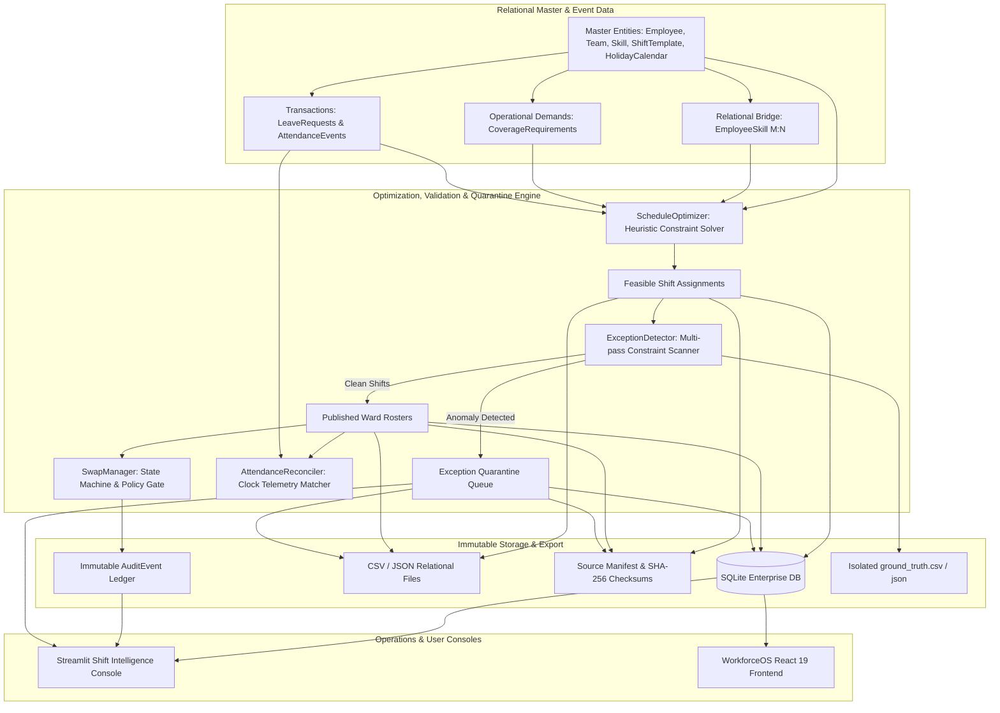
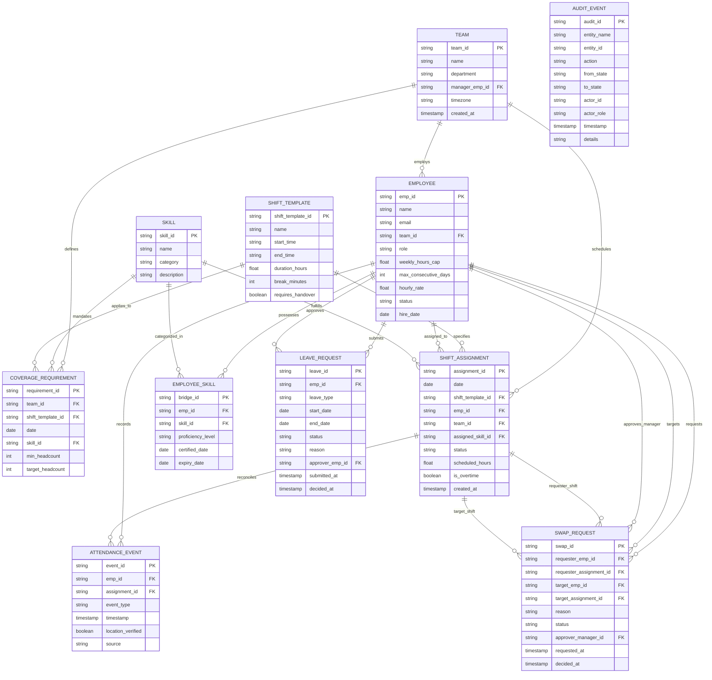

# System Architecture & Technical Specification

> **Candidate:** Marupuri Venkata Yaswanth (`marupurivenkata@gmail.com`)  
> **Challenge:** YottaFlex AI Candidate Project — Enterprise Workforce Scheduling Platform  
> **Submission Window:** 72-Hour Code Challenge (Round 3)

---

## 1. Executive Summary & Objective

Workforce management in healthcare clinical wards requires continuous balance between patient acuity demands and strict labor regulations. The **YottaFlex Enterprise AI Workforce Scheduling Platform** is an end-to-end operational engine that harmonizes:
1. **Mandatory Clinical Staffing Ratios:** Required headcounts per shift rotation (Day, Evening, Night) and ward specialty (ICU, Emergency, Surgery).
2. **Specialized Skill Certifications:** Mandatory competency requirements (e.g. ACLS, BLS, Triage, PALS) verified via bridge relationships.
3. **Employee Availability & Absence Windows:** Respecting approved annual, sick, and emergency leave requests without silent scheduling collisions.
4. **Labor Law & Fairness Constraints:** Weekly 40-hour caps, maximum consecutive working days (5 days), minimum 11-hour rest intervals, and equitable weekend rotation balancing measured via the Gini Index.
5. **Exception Traceability & Audit Gating:** Isolating anomalies in a quarantine queue with 1-click remediation, preserving every state change in an immutable `AuditEvent` ledger.

---

## 2. Architecture & Data Flow

---

## 3. Entity Relationship Diagram (ERD)

---

## 4. Primary Actors & Responsibilities

| Actor / System | Functional Touchpoints & Responsibilities |
|---|---|
| **Employee / Candidate** | Submits leave requests, browses published personal rosters, initiates peer-to-peer shift swap proposals. |
| **Nurse Manager / Department Lead** | Evaluates and approves leave requests, reviews coverage shortfalls, authorizes shift swaps, resolves quarantined exceptions. |
| **HR Partner** | Configures labor compliance policies (weekly 40h cap, rest periods, overtime authorization gates, holiday pay multipliers). |
| **IT / Operations Partner** | Supervises biometric attendance badge readers, integration pipelines, and cryptographic dataset verification. |
| **System Administrator** | Manages master data (Teams, Skills, ShiftTemplates), reviews immutable audit trails, triggers deterministic data generation. |

---

## 5. Constraint Optimization & Exception Handling

### Hard Constraints (Non-Negotiable)
1. **Feasibility (Zero Double-Booking):** An employee cannot be assigned to more than one shift within any 24-hour cycle.
2. **Absence Protection:** Zero shifts scheduled for an employee during an `APPROVED` leave request window.
3. **Clinical Competency:** Every shift rotation must meet or exceed `min_headcount` with staff certified in the mandatory skill.
4. **Labor Cap:** Cumulative weekly scheduled hours cannot exceed `weekly_hours_cap` (40.0h) without an explicit overtime waiver.

### Soft Objectives (Optimized)
1. **Workload Equity (Gini Index Minimization):** Distributes total monthly hours evenly among team members to prevent nurse burnout.
2. **Weekend Shift Balancing:** Distributes Saturday/Sunday shifts equally across the roster cycle.
3. **Shift Continuity:** Minimizes erratic rotation switching (e.g. Day to Night to Day) to promote circadian rhythm health.

---

## 6. Immutable Audit Event Architecture

Every state mutation in the platform generates an immutable `AuditEvent` containing:
- `audit_id`: Deterministic zero-padded identifier (`AUD-000001`).
- `entity_name`: Target entity class (`ShiftAssignment`, `SwapRequest`, `LeaveRequest`, `Exception`).
- `entity_id`: Primary key of the affected record.
- `action`: Event classification (`CREATE`, `STATE_TRANSITION`, `SWAP_EXECUTE`, `EXCEPTION_QUARANTINE`, `OVERRIDE`).
- `from_state` $\to$ `to_state`: Exact lifecycle transition.
- `actor_id` & `actor_role`: Responsible party (`Manager`, `Employee`, `System Administrator`).
- `timestamp`: UTC ISO timestamp.
- `details`: Tamper-evident trace.
