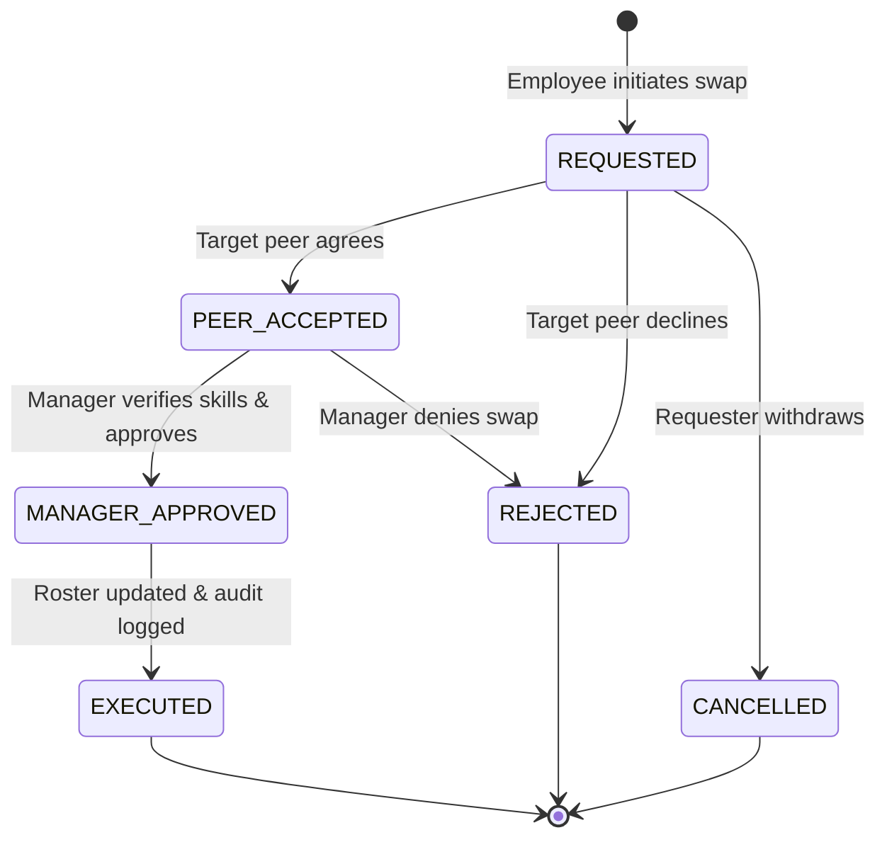

# Design System, Algorithmic Choices & Engineering Trade-offs

> **Candidate:** Marupuri Venkata Yaswanth (`marupurivenkata@gmail.com`)  
> **Challenge:** YottaFlex AI Candidate Project — Enterprise Workforce Scheduling Platform  
> **Submission Window:** 72-Hour Code Challenge (Round 3)

---

## 1. UI/UX Design System Specification

The user interface follows the high-craft product design principles of **Linear-app** and **Stripe Dashboard**:
- **Canvas Atmosphere:** Deep charcoal canvas (`#08090a`) providing a calm, focused environment for clinical managers.
- **Surface Elevation:** Subtle layered surfaces (`#0f1115` $\to$ `#15181e` $\to$ `#1c2028`) with 1px hairline borders (`#242933`).
- **Semantic Accents:** Signature Linear Indigo (`#5e6ad2`) for primary actions, Emerald (`#10b981`) for safety compliance, Ruby (`#f43f5e`) for critical exceptions, and Amber (`#f59e0b`) for pending managerial reviews.
- **Typography:** Inter sans-serif for UI labels and tabular numerical clarity, paired with JetBrains Mono for system IDs and cryptographic hashes.

---

## 2. Mathematical Formulations & Optimization Algorithms

### 2.1 Workload Fairness (Gini Index Formulation)

To evaluate equitable shift allocation and prevent nurse overtime burnout, the engine computes the Gini Coefficient over cumulative assigned hours:

$$G = \frac{2 \sum_{i=1}^n i \cdot y_{(i)}}{n \sum_{i=1}^n y_{(i)}} - \frac{n + 1}{n}$$

Where:
- $n$: Number of active employees in the clinical department.
- $y_{(i)}$: Cumulative scheduled hours for employee $i$, sorted in non-decreasing order ($y_{(1)} \le y_{(2)} \le \dots \le y_{(n)}$).
- $G \in [0, 1]$: $0.0$ represents perfect mathematical equality (all nurses work identical hours); $1.0$ represents total inequality.
- **Target Threshold:** $G \le 0.30$ indicates a highly fair and balanced hospital schedule.

---

### 2.2 Heuristic Constraint Satisfaction Solver

The `ScheduleOptimizer` applies a prioritized greedy search over the multi-ward requirement matrix:
1. **Hard Feasibility Filter:**
   $$\text{Candidate}(e, d, r) \iff (e, d) \notin \text{Assigned} \land (e, d) \notin \text{ApprovedLeaves} \land r_{\text{skill}} \in \text{Skills}(e) \land H_{\text{week}}(e) + 8 \le \text{Cap}(e)$$
2. **Fairness Prioritization Sorting:**
   $$\text{Priority}(e) = \arg \min_e \left( H_{\text{week}}(e), H_{\text{total}}(e) \right)$$
   Employees with the lowest accrued hours in the active week are scheduled first, minimizing weekly standard deviation.

---

### 2.3 Exception Quarantine & Ground Truth Isolation

The exception quarantine engine implements a deterministic rule-based scanner that isolates anomalies into separate dataframes without corrupting input features:

| Anomaly Type | Formal Detection Predicate | Remediation Protocol |
|---|---|---|
| `DOUBLE_BOOKED_EMPLOYEE` | $\text{count}(\text{Assignment}(e, d)) > 1$ | De-duplicate overlapping assignment; reassign to open pool. |
| `LEAVE_OVERLAPPING_SHIFT` | $\exists l \in \text{Leaves} : l_{\text{status}} = \text{'APPROVED'} \land l_{\text{start}} \le d \le l_{\text{end}}$ | Unassign employee; flag shift as OPEN for relief coverage. |
| `REQUIRED_SKILL_ABSENT` | $\sum_{a \in \text{Shift}} \mathbf{1}(r_{\text{skill}} \in \text{Skills}(a)) < r_{\text{min}}$ | Alert department lead; reallocate on-call certified staff. |
| `OVERTIME_CAP_EXCEEDED` | $\sum_{d \in \text{Week}} H(e, d) > \text{Cap}(e)$ | Require managerial overtime waiver or rebalance shift load. |
| `UNAPPROVED_SWAP_APPLIED` | $\text{Swap}_{\text{status}} = \text{'EXECUTED'} \land \text{Approver} = \text{NULL}$ | Revert shift ownership to original holders; flag audit alert. |

---

## 3. Shift Swap State Machine

Shift swaps are governed by a strict unidirectional lifecycle:

**Security Gate:** Direct transitions from `REQUESTED` $\to$ `EXECUTED` are strictly rejected and quarantined as `UNAPPROVED_SWAP_APPLIED`.

---

## 4. Attendance Telemetry Reconciliation

The platform cross-references biometric/badge events ($t_{\text{actual}}$) against scheduled start times ($t_{\text{scheduled}}$):
- **ON_TIME:** $-15\text{ min} \le t_{\text{actual}} - t_{\text{scheduled}} \le +15\text{ min}$
- **TARDY:** $t_{\text{actual}} - t_{\text{scheduled}} > 15\text{ min}$
- **EARLY_DEPARTURE:** $t_{\text{end}} - t_{\text{actual}} > 15\text{ min}$
- **NO_SHOW:** $\nexists \text{ClockIn}(e, \text{assignment})$ after shift completion.
