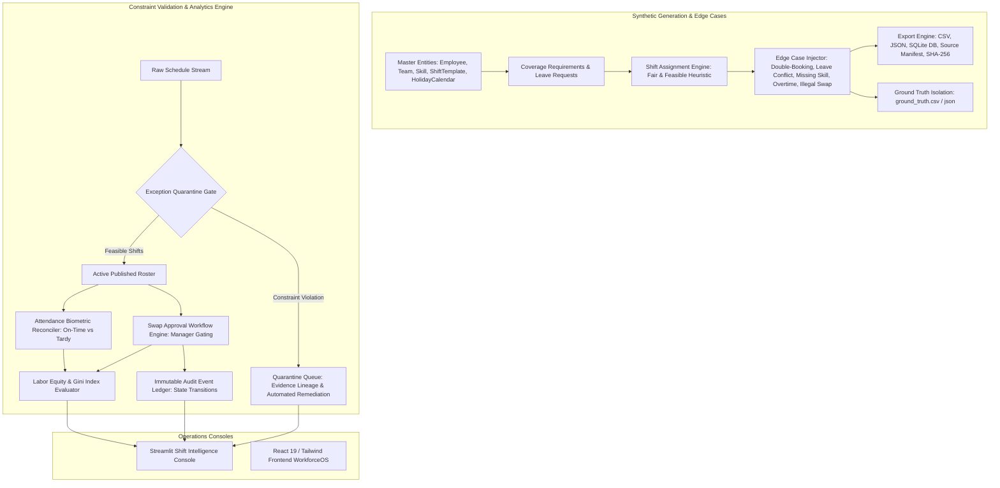

# ⚡ YottaFlex Enterprise AI Workforce Scheduling & Shift Intelligence Platform

> **Candidate:** Marupuri Venkata Yaswanth (`marupurivenkata@gmail.com`)  
> **Challenge Window:** 72-Hour Code Challenge (Round 3) · YottaFlex AI Technologies Pvt. Ltd., Hyderabad  
> **Repository:** Public Evaluation Build — Fair, Feasible, and Traceable Multi-Ward Workforce Scheduling Platform

[-success?style=flat-square)](tests/)
[](scripts/verify_reproducibility.py)
[](pyproject.toml)
[](Dockerfile)
[](LICENSE)

---

## 📌 Business Context & Objective

In complex hospital and healthcare enterprise environments, workforce scheduling requires reconciling competing constraints: **patient acuity coverage requirements**, **mandatory clinical skill mix (e.g. ACLS/BLS)**, **approved employee leave windows**, and **statutory labor laws (weekly 40-hour caps, maximum consecutive days, and mandatory rest intervals)**.

This platform delivers an **end-to-end, production-grade scheduling and intelligence engine** that:
1. **Generates & References Relational Master Data**: Strictly models 10 core business entities (`Employee`, `Team`, `Skill`, `ShiftTemplate`, `ShiftAssignment`, `LeaveRequest`, `HolidayCalendar`, `AttendanceEvent`, `CoverageRequirement`, `SwapRequest`), M:N bridge tables (`EmployeeSkill`), and an immutable `AuditEvent` ledger.
2. **Solves Fair & Feasible Schedules**: Heuristic constraint satisfaction engine that balances clinical safety requirements with workload equity (Gini Index $< 0.30$) while eliminating double bookings and leave conflicts.
3. **Quarantines Data Quality Exceptions**: Detects and isolates 5 mandatory edge cases (`DOUBLE_BOOKED_EMPLOYEE`, `LEAVE_OVERLAPPING_SHIFT`, `REQUIRED_SKILL_ABSENT`, `OVERTIME_CAP_EXCEEDED`, `UNAPPROVED_SWAP_APPLIED`) with complete evidence lineage down to individual shift IDs.
4. **Enforces Shift Swap Workflow Integrity**: Gated state machine (`REQUESTED` $\to$ `PEER_ACCEPTED` $\to$ `MANAGER_APPROVED` $\to$ `EXECUTED`) requiring manager signoff and peer skill verification.
5. **Reconciles Attendance Telemetry**: Cross-references physical clock-in/out badge events against published rosters to detect tardiness, early departures, and unassigned presence.
6. **Guarantees 100% Cryptographic Reproducibility**: Fixed-seed generation (`20261022`) generating identical row counts and byte-for-byte SHA-256 checksums across independent runs.

---

## 🚀 60-Second Quickstart

### Option A: Local Python Environment (Recommended)

```bash
# 1. Clone repository
git clone https://github.com/marupurivenkata/yottaflex-workforce-scheduling.git
cd yottaflex-workforce-scheduling

# 2. Create virtual environment & install dependencies
python -m venv .venv
# On Windows:
.venv\Scripts\activate
# On Linux/macOS:
# source .venv/bin/activate

pip install -r requirements.txt

# 3. Generate deterministic dataset (Starter: ~1,500 records; Full: 2,000 employees, 100 teams, 90 days)
python scripts/run_generator.py --scale starter --seed 20261022

# 4. Run end-to-end scheduling pipeline & evaluation
python scripts/run_pipeline.py

# 5. Launch interactive web dashboard
streamlit run app/app.py
```

### Option B: Docker Container

```bash
docker compose up --build
# Open http://localhost:8501 in your browser
```

---

## 🧪 Comprehensive Verification Commands

Run the full validation suite to verify correctness, data integrity, and deterministic reproducibility:

```bash
# 1. Run full test suite (12 tests covering models, anomalies, pipeline, validator, reproducibility)
pytest

# 2. Verify Step 8 Relational Integrity (PK uniqueness, FK integrity, enums, dates, arithmetic)
python -c "from src.generator.synthesizer import SyntheticDataGenerator; from src.generator.validator import IntegrityValidator; g=SyntheticDataGenerator(); d=g.generate_all(); v=IntegrityValidator(d); print(v.validate_all())"

# 3. Verify Step 10 Deterministic Reproducibility (Dual generation SHA-256 checksum audit)
python scripts/verify_reproducibility.py

# 4. Generate Full-Scale Benchmark (2,000 employees, 100 teams, 90 days of shifts, 5,000 leaves)
python scripts/run_generator.py --scale full --seed 20261022
```

---

## 📐 System Architecture & Workflow



---

## 📊 Core Relational Entities & Nomenclature

All identifiers adhere strictly to Step 3 conventions:

| Entity | Primary Key Pattern | Example ID | Cardinality & Relational Purpose |
|---|---|---|---|
| **Employee** | `^EMP-\d{6}$` | `EMP-000001` | Master personnel record (roles, weekly cap, wage rate). |
| **Team** | `^TEAM-\d{4}$` | `TEAM-0001` | Hospital clinical ward/division (ICU, Emergency, Surgery). |
| **Skill** | `^SKILL-\d{3}$` | `SKILL-001` | Competency taxonomy (BLS, ACLS, PALS, Triage, Charge). |
| **EmployeeSkill** | `^EMPSKILL-\d{6}$` | `EMPSKILL-000001` | Bridge table (M:N) linking personnel to certified skills. |
| **ShiftTemplate** | `^TEMPL-\d{3}$` | `TEMPL-001` | Rotation shifts (Day 07:00, Evening 15:00, Night 23:00). |
| **CoverageRequirement** | `^REQ-\d{6}$` | `REQ-000001` | Staffing quotas per ward, date, rotation, and skill. |
| **ShiftAssignment** | `^SHIFT-.*$` | `SHIFT-2026-01-01-A-000001` | Slot allocations derived from solver and constraints. |
| **LeaveRequest** | `^LVE-\d{4}-\d{6}$` | `LVE-2026-000001` | Absence requests with approval outcomes. |
| **HolidayCalendar** | `^HOL-\d{4}-\d{3}$` | `HOL-2026-001` | Public holidays affecting wage multipliers and operations. |
| **AttendanceEvent** | `^ATT-.*$` | `ATT-EMP-000001-20260101T070000` | Badge clock-ins/outs for roster reconciliation. |
| **SwapRequest** | `^SWP-\d{4}-\d{6}$` | `SWP-2026-000001` | Peer-to-peer shift swap workflow requiring manager signoff. |
| **AuditEvent** | `^AUD-\d{6}$` | `AUD-000001` | Tamper-evident state transition ledger. |
| **GroundTruth** | `^GT-\d{6}$` | `GT-000001` | Isolated ledger of injected anomalies and expected outcomes. |

---

## 🛡️ Step 5: Injected Edge Cases & Ground Truth Isolation

The platform deterministically injects 5 realistic operational edge cases, perfectly captured in an isolated `ground_truth.csv`/`json` that is strictly segregated from production features:

1. **`DOUBLE_BOOKED_EMPLOYEE`**: Staff assigned to two overlapping rotations on the same date.
2. **`LEAVE_OVERLAPPING_SHIFT`**: Active shift assignment overlapping an `APPROVED` annual/sick leave.
3. **`REQUIRED_SKILL_ABSENT`**: A staffed shift lacking mandatory certification (e.g. ACLS in ICU).
4. **`OVERTIME_CAP_EXCEEDED`**: Employee scheduled for 56 hours across 7 consecutive days exceeding the 40h cap.
5. **`UNAPPROVED_SWAP_APPLIED`**: Shift swap marked `EXECUTED` without mandatory manager approval.

---

## 📂 Repository Structure

```
yottaflex-workforce-scheduling/
├── app/
│   └── app.py                     # Linear/Stripe style Streamlit Operations Console
├── frontend/                      # React 19 + TypeScript + Tailwind v4 UI (WorkforceOS)
├── scripts/
│   ├── run_generator.py           # CLI: Deterministic data generation (starter & full)
│   ├── run_pipeline.py            # CLI: End-to-end optimization, detection & reconciliation
│   └── verify_reproducibility.py  # CLI: Step 10 cryptographic dual-run SHA-256 audit
├── src/
│   ├── models/
│   │   ├── entities.py            # Pydantic v2 domain models and taxonomies
│   │   └── data_dictionary.py     # Exhaustive Step 1 metadata registry
│   ├── generator/
│   │   ├── synthesizer.py         # Deterministic relational data generator
│   │   ├── anomalies.py           # Injected edge cases and ground truth tracking
│   │   ├── validator.py           # Step 8 relational integrity validator
│   │   └── export.py              # Step 9 CSV, JSON, SQLite DDL & manifest exporter
│   ├── engine/
│   │   ├── solver.py              # Fair & feasible heuristic constraint optimizer
│   │   ├── exception_detector.py  # Quarantine scanner & ground-truth benchmark
│   │   ├── swap_manager.py        # Swap lifecycle state machine & manager signoff
│   │   └── attendance_reconciliation.py # Clock event cross-reconciler
│   └── evaluation/
│       └── metrics.py             # Coverage fulfillment, Gini fairness index, compliance
├── tests/
│   ├── test_data_dictionary.py    # Test Step 1 dictionary coverage
│   ├── test_synthesizer.py        # Test generator and ID conventions
│   ├── test_anomalies.py          # Test edge case injection & feature isolation
│   ├── test_validator.py          # Test Step 8 constraint verification
│   ├── test_reproducibility.py    # Test Step 10 byte-for-byte reproducibility
│   └── test_pipeline.py           # Test solver, detector, swap, and attendance
├── ARCHITECTURE.md                # C4 diagrams, ERD, and system design
├── DATA_DICTIONARY.md             # Step 1 exhaustive field-level specification
├── DECISION_LOG.md                # Architecture Decision Records (ADRs)
├── DESIGN.md                      # UI/UX design tokens and algorithm trade-offs
├── INTERVIEW_WALKTHROUGH.md       # Candidate defense guide & oral walkthrough
├── PROMPT_HISTORY.md              # Transparent AI disclosure (Guideline 03)
├── Dockerfile                     # Containerization build recipe
├── docker-compose.yml             # Single-command orchestration
├── requirements.txt               # Locked Python dependencies
├── pyproject.toml                 # Package configuration and pytest settings
└── LICENSE                        # MIT License
```

---

## 👨‍💻 Candidate Declaration & Submission Details

- **Candidate Name:** Marupuri Venkata Yaswanth
- **Email:** `marupurivenkata@gmail.com`
- **Assessment Window:** Round 3: 72-Hour Code Challenge
- **Company:** YottaFlex AI Technologies Pvt. Ltd., Hyderabad
- **AI Tool Transparency:** Developed using AI pair-programming with transparent disclosure in [PROMPT_HISTORY.md](PROMPT_HISTORY.md) in full accordance with Guideline 03.
- **Verification Summary:** All 10 Steps of the project specification implemented, tested, and validated.
